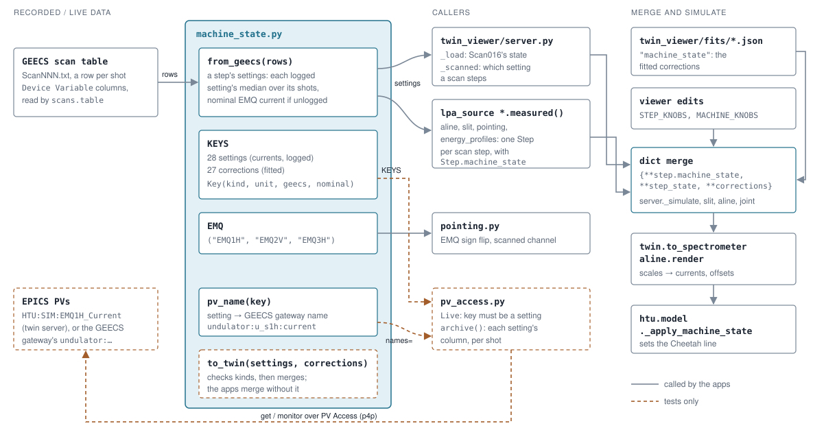

# How the apps use the machine state

Where `htu_twin_apps.machine_state` is called, from a recorded scan's rows to the HTU twin's line.
The keys themselves, with their GEECS columns and PV names, are in
[`htu-pv-translation.md`](htu-pv-translation.md).

Solid arrows are the apps' path; dashed ones are used only by the tests. Click the image for
its full size.

- **`from_geecs()`** is the entry point. Each `measured()` in `lpa_source` (`aline`, `slit`,
  `pointing`, `energy_profiles`) calls it once per scan step, and the twin viewer calls it for
  Scan016's settings and to find the setting a scan steps.
- **The merge is done by the callers**, with plain dicts: a step's settings, the viewer's edits
  (`step_state`) and a fit's corrections (`fits/*.json`, the A-line camera's pixel size removed).
  `twin.to_spectrometer` and `aline.render` turn the scales and offsets into the twin's currents
  and misalignments, and `htu.model._apply_machine_state` sets the line.
- **`EMQ`** is used by `pointing.py`, to flip the EMQs' sign and find the EMQ a scan steps.
- **`to_twin()`** checks that each key is of its kind before merging, but the apps don't call it:
  `tests/machine_state_test.py` uses it to check that the fits' corrections are correction keys.
- **`pv_access`** (with `KEYS` and `pv_name()`) is not called by the apps yet; the tests use it.

| `machine_state` | Called from | For |
|---|---|---|
| `from_geecs` | `twin_viewer/server.py` (`_load`, `_scanned`) | Scan016's settings; the setting a scan steps |
| `from_geecs` | `lpa_source/aline.py`, `slit.py`, `pointing.py`, `energy_profiles.py` (`measured`) | each step's `Step.machine_state` |
| `EMQ` | `lpa_source/pointing.py` | the EMQs' sign; the EMQ a scan steps |
| `KEYS`, `SETTING` | `pv_access.py` (`Live`, `archive`) | a key is a setting; each setting's column |
| `pv_name` | tests; `pv_access.Live(names=...)` | the GEECS gateway's PV names |
| `to_twin` | tests | the fits' corrections are correction keys |
