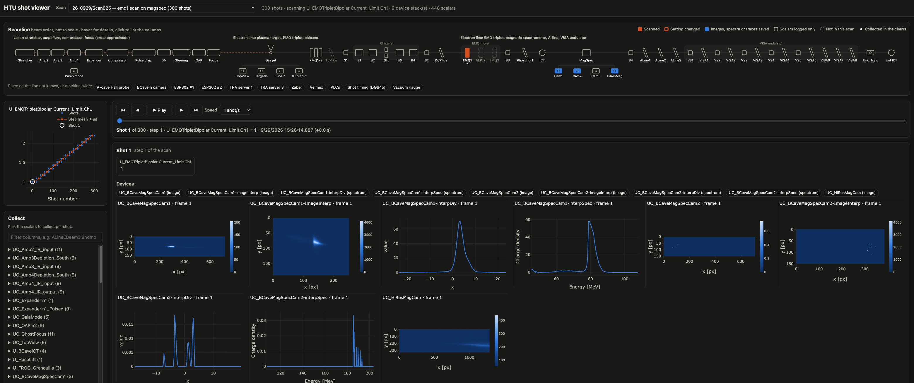
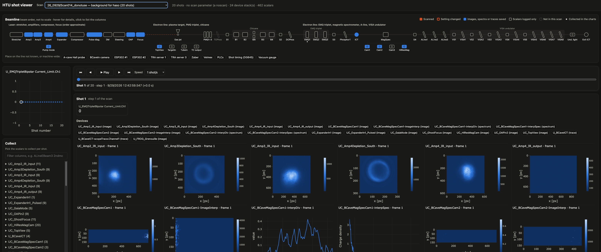

# HTU shot viewer

A small local web app for HTU scan folders: pick a scan, collect the scalars you want, and look at
them shot by shot, with each device's image or spectrum for that shot, and a schematic of the
beamline that marks what the scan changed and saved.



*Scan025, an EMQ1 scan on the magnetic spectrometer: EMQ1 is marked as scanned, and the shot
panel shows the spectrometer images and spectra for the shot on view.*



*Scan014 of 2026-09-29, a background noscan: the beamline marks the laser-chain cameras, the ICT and the
spectrometer cameras as saved, and the shot panel shows the amplifier images.*

## Run

Install the repository (see the [top-level README](../../README.md)), then:

```bash
htu-shot-viewer <day> ... [--root <data root>] [--port N]
```

Ex., the command it was developed with (two days on port 8010):

```bash
htu-shot-viewer 26_0929 26_1001 --root <data root> --port 8010
```

Run from a clone without installing the package, the same command is:

```bash
cd <repo>
PYTHONPATH=$PWD python -u -m htu_twin_apps.shot_viewer.server 26_0929 26_1001 \
    --root <data root> --port 8010
```

`<data root>` is the folder holding `Undulator/Y2026/...`; `--port` defaults to 8050.

The days are day names such as `26_0929`, found as `<data root>/Y2026/09-Sep/26_0929` (`--root` is
HTU's `Undulator` folder, or the folder holding it), or the paths of
day folders. The viewer never searches the data tree above the days.

Open the port's page (<http://127.0.0.1:8010> above; 8050 by default). The server only listens on this machine. The page loads Plotly from
cdn.jsdelivr.net, so the browser needs internet access.

## What it does

- **Scans:** every `scans/*` folder of the days given on the command line with a
  `ScanDataScan*.txt` (whatever the folder is called, as `Scan014_donotuse`; the menu lists it as
  `<day>/<folder name>`, and the list is built when the server starts, so a scan added later needs
  a restart); only those days' `scans/` and `analysis/` folders are read. The menu shows
  each scan's description from its
  `ScanInfoScan*.ini`. A scan whose raw folder is missing but whose analysis table
  (`analysis/s<N>.txt`) is there is listed as "scalars only": its scalars can be collected,
  charted and exported, but it has no device stacks, description or scan parameter.
- **Collect:** tick scalar columns of the scan table, grouped by device (filter to find them). Each
  collected column gets a chart against the x axis you choose: shot number, the scan parameter, the
  scan step or another collected column. The step mean ± standard deviation is drawn on top. A table
  view lists the collected values per shot, and "Download CSV" saves them, one row per shot.
- **A shot:** opening a scan opens its first shot; click a point (or a table row) to open another.
  The shot panel shows the collected values, the frame of every device stack for that shot
  (images as heatmaps, spectra as lines; toggle devices on and off), the machine settings, and all
  the shot's scalars. The charts mark the shot with a ring.
- **Moving through time:** the timeline bar stays at the top of the page. It shows the shot, its
  scan step, the scan parameter's value and the shot's time (and the seconds since the scan
  started). Drag the slider, use the first/previous/next/last buttons or the arrow keys, or press
  Play (or the space bar) to step through the shots at 0.5 to 4 shots per second. Playback waits
  for each shot's images before moving on. Dragging the slider shows each shot it passes at once
  but loads a shot's images (and its scalars) only once the slider rests for 0.2 s, so a drag over
  many shots does not request every frame in between. Zooming into an image keeps the zoom while
  stepping.
- **Machine settings:** the shot's magnet currents and voltages (EMQ triplet, chicane, steerers),
  Hall probes, ICT charge monitors, VISA screen plungers, gas jet, PMQ hexapod, laser and other
  motion stages, timing and vacuum, grouped by system. By
  default only those that change during the scan are listed, with their range over the scan; a
  value that changed since the previous shot is highlighted with its previous value. A change
  counts only above 0.5 % of the setting's typical size, and at least 0.005 in its units, so the
  readback jitter of the power supplies is ignored.
- **Beamline:** a schematic of the line in beam order (not to scale): the laser chain, the
  plasma target, PMQ triplet and chicane, then the EMQ triplet, magnetic spectrometer, A-line and
  VISA undulator. Each element is marked by what the scan did with it: scanned, a setting changed,
  images, spectra or traces saved, scalars logged only, or absent; a dot marks the elements whose
  columns are collected. Hover for its devices and changes, click to list its columns. The
  electron line follows geecs-lume-twin's `htu/lattice.py`; the laser chain's order, the
  target-chamber cameras and the ICT positions are inferred from the device names, and devices
  whose place is unknown sit in a tray below. A wide window puts more of the line on each row.
- **Links:** the address bar holds the view (scan, collected columns, x axis and shot), so a view
  can be bookmarked or shared.

## How shots are matched

The scalar table has one row per shot. A device stack (`<device>/<device>.h5`, dataset
`entry/data/data`) holds one frame per saved shot, with its acquisition time in
`entry/instrument/NDAttributes/*frame_acq_timestamp`. A frame belongs to the shot whose
`<device> acq_timestamp` column is within 50 ms of it. The table's times are LabVIEW times (seconds
since 1904), 2 082 844 800 s ahead of the stack's Unix times. Shot and frame counts can differ
(Scan029 has 301 rows and 300 frames), so frames are not matched by position.

Images wider or taller than 400 pixels are block-averaged before they are sent to the browser; the
axes stay in camera pixels.
