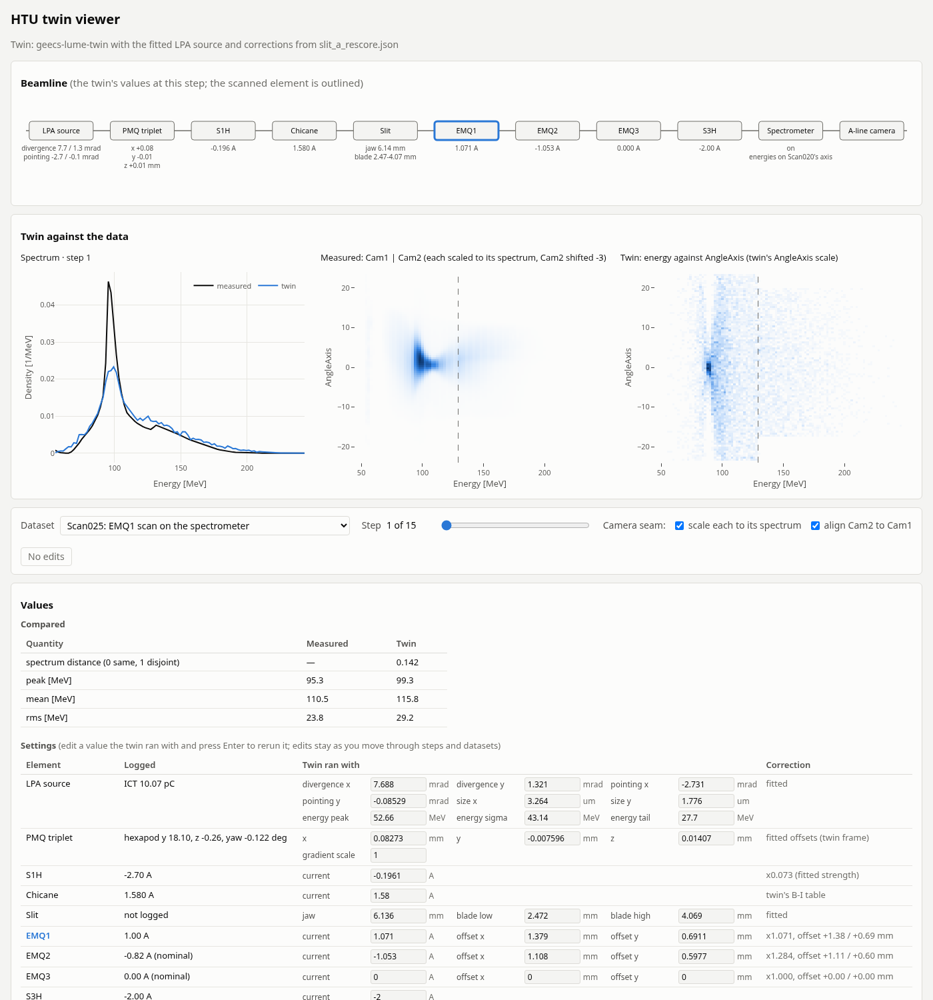
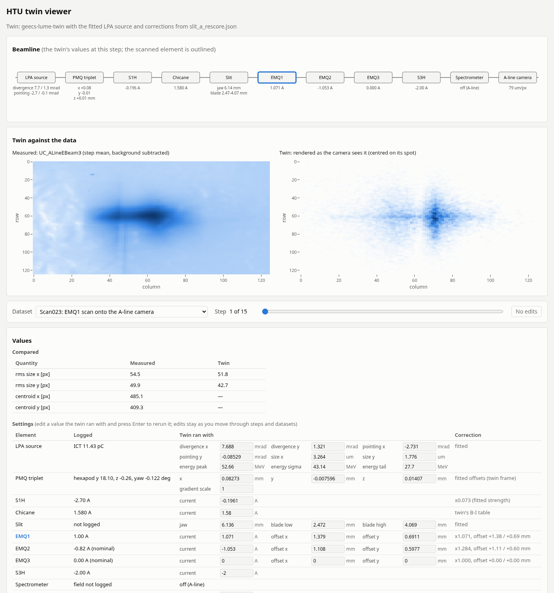

# HTU twin viewer

A small local web app that runs the HTU twin, with the fitted LPA source and the fitted
corrections, at the logged settings of a recorded scan step and shows it beside that step's
measurement. Pick a dataset, move the step slider, and the page shows the beamline synoptic with
the values the twin ran with, the twin's output against the data, and the numbers below.



*Scan025, step 1: EMQ1 is the scanned element; the spectrum, the measured ImageInterp and the
twin's energy–AngleAxis image, with the compared values and the settings below.*



*Scan023, step 1: the A-line camera frame (background subtracted) and the twin's spot rendered at
the fitted pixel size.*

## Run

Install the repository (see the [top-level README](../../README.md)), then:

```bash
htu-twin-viewer <data directory>        # or set $HTU_DATA
```

Open <http://127.0.0.1:8060>. Options: `--port N`, `--particles N` (default 20000), `--threads N`
(torch threads, default 2), `--source FILE` (a fit's saved source JSON) and `--fits DIR` (where the
source is looked for, default `~/save/inversion/fits`). Without `--source`, the first of
`aline_axis_source.json`, `aline_image_source.json` and `aline_offsets_source.json` found in the
fits directory is used. `?scan=Scan025` in the URL opens that dataset. The page loads Plotly from
cdn.jsdelivr.net.

The server listens on all interfaces (so a VM's forwarded port works); it has no access control.

## What it does

- **Datasets:** Scan016 (spectrometer, everything out), Scan019 and Scan020 (spectrum), Scan023 and
  Scan026 (A-line camera) and Scan025, Scan028 and Scan030 (spectrometer). Each step is the twin at
  that step's logged settings.
- **Synoptic:** the electron line in beam order with the twin's value for each element; the
  scanned element is outlined. Hover an element for its logged value and correction.
- **Twin against the data:** the spectrum (measured and twin) for the spectrometer datasets; for
  Scan025–030 also the measured `-ImageInterp` (Cam1 and Cam2) and the twin's energy against
  AngleAxis; for the A-line datasets the step-mean frame and the twin's spot rendered as the camera
  sees it.
- **Values:** the compared quantities (spectrum distance, peak, mean and rms energy; A-line rms
  sizes and centroids) and a settings table: logged value, what the twin ran with, and the fitted
  correction.
- **Edits:** the "Twin ran with" values are inputs. Change one and press Enter (or leave the
  field) to rerun the twin with it; an edited field is outlined, and emptying it restores the fit's
  value. Editable: the source's divergence, pointing, size and energy shape; the PMQ triplet's
  offsets and gradient scale; the magnet currents (S1H, chicane, EMQ1–3, S3H); the EMQs' offsets;
  the slit's jaw and blade; the A-line pixel size. An edited current is what the twin's magnet
  sees (the fitted scale is not applied to it), and it replaces the logged value at every step,
  so editing the scanned magnet makes every step the same. Edits stay as you move through steps
  and datasets until "Reset edits". The API takes them as `edits=` JSON on `/api/step`
  (see `server.py`).

- **Camera seam** (spectrometer datasets): the measured image is Cam1 below 129.3 MeV and Cam2
  above (the dashed line). Each camera's ImageInterp is in its own raw counts (Cam2 about 6 times
  Cam1 for the same charge) and its own AngleAxis zero (about 3 apart), so two options correct the
  stitch, both on by default: "scale each to its spectrum" scales each camera's image to its
  `-interpSpec`, and "align Cam2 to Cam1" shifts Cam2, by whole 0.5 bins, so that its AngleAxis
  centroid within 4 MeV of the seam matches Cam1's, per step. The shift is shown in the image's
  title. The alignment assumes the beam does not jump at the seam; the fits use neither.

Each step's result is cached; a step not yet run takes a few seconds, and a background thread runs
the remaining steps of the dataset on view.

## Caveats

- Energies use the early (Scan020) spectrometer axis for every scan (hypothesis A of the energy
  axis mislabelling); see `lpa_source.scans.energy_axis`.
- The twin's AngleAxis scale is not the data's, so compare the two images' shapes, not their
  vertical extent.
- The twin's A-line spot is centred on its own centroid, so no twin centroid is shown: comparing
  centroids needs the camera zeros the A-line fit finds per scan.
- 20,000 particles: the twin's images are noisy; raise `--particles` for smoother ones.
